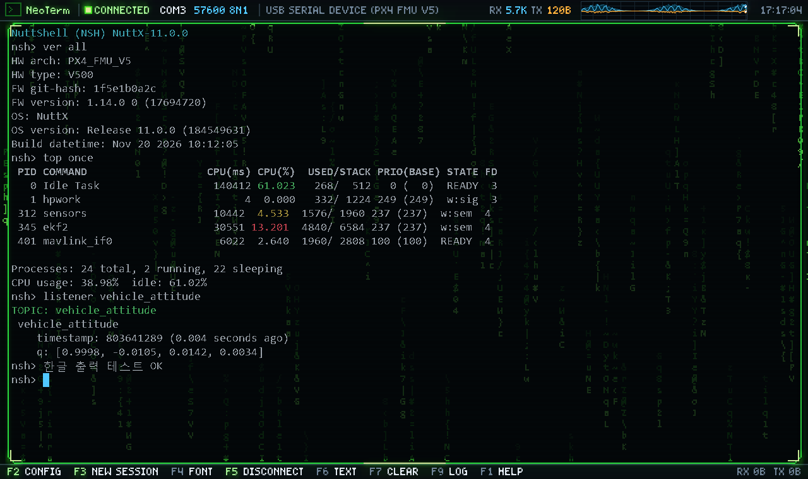
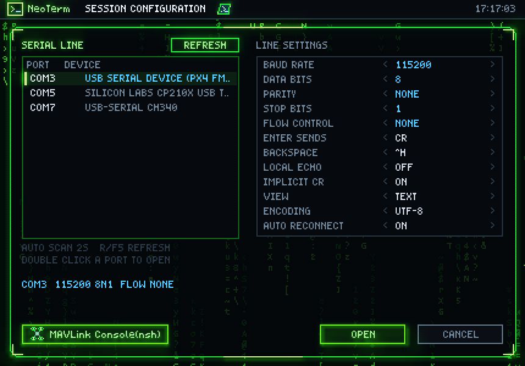
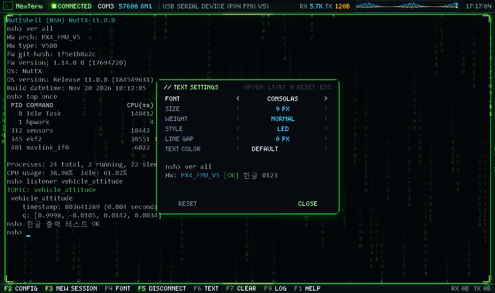

# NeoTerm 1.0

A Windows serial terminal loaded with unnecessary decorations. Like PuTTY, you pick a port in the session configuration window and open it, and the terminal window appears.
The **MAVLink Console (nsh)** of PX4 flight controllers and a local **PowerShell** run in the same window too.



## Download

Get `NeoTerm.exe` from [Releases](../../releases) and run it. No installation and no other files are needed.

- Windows 10 (1809 or later) / Windows 11, 64-bit
- The exe is not code-signed, so on first launch Windows may show "Windows protected your PC". Click **More info → Run anyway**. Each release lists the SHA-256 of `NeoTerm.exe` so you can check the download (`Get-FileHash NeoTerm.exe`).
- Run it as a normal user; administrator rights are not needed.
- Drivers for USB-serial adapters (CH340, CP210x, FTDI, ...) must be installed separately.

## Features

| | |
|---|---|
|  |  |

- **Serial terminal** — baud rate (custom values allowed), data bits, parity, stop bits, flow control, Enter/Backspace codes, local echo, UTF-8 / CP949 (Korean) / ASCII, auto reconnect. The port list updates by itself when USB devices are plugged in or out.
- **Connection status** — CONNECTING... while the port is open but nothing has been received yet (or while auto reconnect retries), CONNECTED once data arrives (MAVLink console: once a PX4 heartbeat arrives; PowerShell: once it prints), DISCONNECTED when you close the link. A serial port cannot tell whether the far end is still alive, so CONNECTED means "something has answered since the port was opened".
- **VT100/ANSI terminal** — colors, cursor movement, 5000-line scrollback, drag selection, copy and paste, IME input (Korean etc.).
- **MAVLink Console (nsh)** — opens the PX4 nsh shell like QGroundControl's MAVLink Console. Connect over USB or a telemetry port and press the *MAVLink Console(nsh)* button (or `M`) in the configuration window. Keystrokes and output travel inside MAVLink `SERIAL_CONTROL` messages.
- **PowerShell** — `P` or the icon next to *SESSION CONFIGURATION* at the top of the configuration window opens a local PowerShell inside the terminal (ConPTY: colors, history, Tab completion, Ctrl+C).
- **AI CLI colours** — while `claude` (Claude Code) or `codex` (OpenAI Codex CLI) runs in that PowerShell, NeoTerm cross-fades to that tool's colours — orange on dark grey for Claude Code, violet for Codex — and back to green when it exits (Ctrl+C, `/exit`) or when you open the configuration window (F2).
- **HEX view** (F6) — RX/TX bytes in hexadecimal with timestamps.
- **Logging** (F9) — everything sent and received is saved as plain text to `Documents\NeoTerm`; turn it off for sessions that involve passwords.
- **Display settings** (F4) — UI scale (window 1–4x, fullscreen AUTO/1–6x), font, size, weight, style (LED / SMOOTH / PIXEL / SHARP), line gap and text color. Changes apply immediately.
- **Multiple sessions** (F3) — open another window to use several ports at once.
- Neon glow (breathing effect), Matrix rain background, CRT scanlines, live RX/TX graph.

## Keys

| Terminal | | Configuration window | |
|---|---|---|---|
| F1 | Help | Tab | Next section |
| F2 | Session configuration | ↑ ↓ / ← → | Select / change value |
| F3 / Ctrl+Shift+N | New session window | Digits | Type a custom baud rate |
| F4 | Display settings (UI scale, text) | R / F5 | Refresh ports |
| F5 | Connect / disconnect | Enter | OPEN |
| F6 | TEXT / HEX view | M / P | MAVLink Console (nsh) / PowerShell |
| F7 | Clear screen | Esc | Cancel |
| F9 | Log to file | F11 | Fullscreen |
| F11 / Alt+Enter | Fullscreen | Ctrl + / - / 0 | UI scale |
| Ctrl + / - / 0 | UI scale up / down / default | | |
| Ctrl+C / Ctrl+V | Copy selection / paste (without a selection Ctrl+C sends ^C; right click also works). Pasted line breaks are sent as Enter, so a multi-line paste runs each line. | | |
| Wheel, Shift+PgUp/PgDn | Scrollback. When the program in the terminal uses the mouse (Claude Code, Codex, ...), the wheel scrolls that program's view; Shift+wheel scrolls NeoTerm's scrollback. | | |

Settings are stored in `%LOCALAPPDATA%\NeoTerm\settings.json`.

## Run from source / build

Python 3.11 on Windows.

```powershell
pip install -r requirements.txt
python neoterm.py          # run
.\build.ps1                # build dist\NeoTerm.exe (PyInstaller, single file)
```

## License

The NeoTerm source code is under the [MIT License](LICENSE).

`NeoTerm.exe` also contains third-party libraries (Python, pygame and the SDL libraries, pyte, pyserial, pywinpty, ...) under their own licenses, including the LGPL. See [THIRD_PARTY_NOTICES.md](THIRD_PARTY_NOTICES.md) for the list and how to use NeoTerm with modified versions of the LGPL libraries; the full license texts are in [`licenses/`](licenses), inside the exe, and in `NeoTerm-licenses.zip` on every release.
